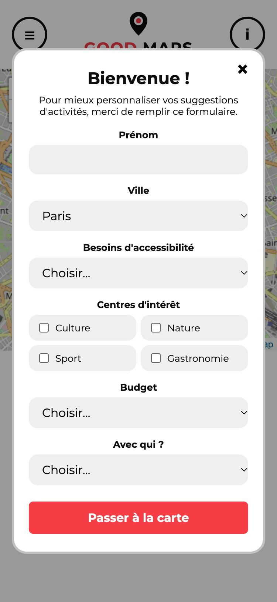
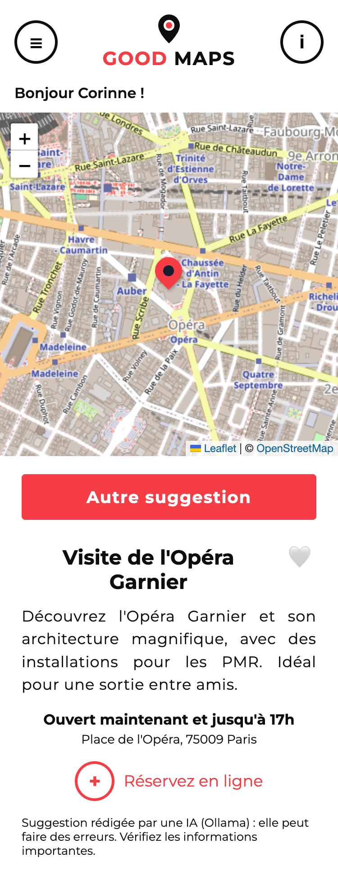

# Good Maps

[](https://github.com/Co-rin-ne/good-maps/actions/workflows/ci.yml)

Application web de **suggestions d'activités adaptées** : l'utilisateur remplit son profil (accessibilité, centres d'intérêt, budget...), et Good Maps lui propose des lieux sur une carte, avec une présentation rédigée par une IA locale.

Projet fil rouge B3 · EPSI.

## Aperçu

| Démarrage | Bienvenue | Carte et suggestion |
|:---:|:---:|:---:|
|  |  |  |

## Fonctionnalités

- **Écran de démarrage** avec le logo
- **Formulaire de bienvenue** : prénom, ville, accessibilité, centres d'intérêt, budget, avec qui. Le profil est mémorisé dans le navigateur
- **Carte** des lieux (marqueurs rouges, popup)
- **Suggestions par IA** : le serveur filtre les lieux selon le profil (accessibilité PMR, budget, centres d'intérêt, ouverts maintenant), puis l'IA en choisit un et rédige sa présentation
- **Fiche du lieu** : horaires (« Ouvert maintenant et jusqu'à 17h »), adresse, réservation en ligne, appel
- **Favoris ❤️ et recommandations** : les lieux aimés sont mémorisés et l'IA propose des lieux qui leur ressemblent
- **Bouton ☰** pour modifier son profil, **bouton ⓘ** pour la page « À propos »

> Les horaires des lieux sont indicatifs et simplifiés.

## Comment fonctionnent les suggestions

L'IA **choisit** parmi des lieux réels, elle **n'invente** ni lieu, ni horaire, ni numéro :

1. Le serveur revérifie le profil (valeurs limitées à des listes de choix)
2. Le **code** filtre les lieux de la base : centres d'intérêt, budget, accessibilité PMR, ouverts maintenant en premier, favoris et lieux déjà vus retirés
3. L'IA (Ollama) reçoit ces lieux et répond en JSON imposé : `{ id_lieu, titre, description }`
4. Le serveur vérifie que `id_lieu` fait partie de la liste, puis renvoie les **vraies** informations de la base
5. Si l'IA ne répond pas ou invente un lieu, une **suggestion de secours** est affichée (avec un message qui le dit)

Le détail de la démarche et des corrections est dans [METHODOLOGIE.md](METHODOLOGIE.md).

## Stack

| Partie | Technologie |
|---|---|
| Front | React + Vite |
| Carte | Leaflet + OpenStreetMap |
| API | Node.js + Express |
| Base de données | SQLite (`node:sqlite`, intégré à Node) |
| IA | Ollama (en local), modèle `llama3.2` |
| Tests | Vitest + Testing Library (client), `node --test` (serveur) |
| CI | GitHub Actions (lint + tests à chaque push et pull request) |

## Structure

```
client/                  → l'interface (React)
  src/components/        → un composant par bloc de la maquette (Carte, FicheSuggestion, Modale...)
  src/services/          → appels à l'API, profil, favoris, horaires
server/                  → l'API (Express)
  routes/                → /api/sante, /api/lieux, /api/suggestions
  services/              → filtrage des lieux, appel à Ollama, validation du profil
  db/                    → schéma SQL et lieux de départ
  tests/
docs/captures/           → captures d'écran du README
.github/workflows/ci.yml → le pipeline de CI
```

## Installation

Prérequis : Node.js 24 ou plus, et [Ollama](https://ollama.com).

```bash
# 0. Le modèle d'IA (une seule fois, environ 2 Go)
ollama pull llama3.2

# 1. L'API
cd server
npm install
cp ../.env.example .env
npm run dev

# 2. Le front (dans un autre terminal)
cd client
npm install
npm run dev
```

Ouvrir ensuite http://localhost:5173.

La base SQLite (`server/goodmaps.db`) est créée automatiquement au premier démarrage, avec les lieux de `server/db/seed.sql`.

> La première suggestion peut prendre une vingtaine de secondes, le temps qu'Ollama charge le modèle. Les suivantes prennent quelques secondes. Si Ollama est éteint, l'appli fonctionne quand même avec des suggestions de secours.

## Configuration (`server/.env`)

| Variable | Rôle | Valeur par défaut |
|---|---|---|
| `PORT` | Port de l'API | `3001` |
| `OLLAMA_URL` | Adresse d'Ollama | `http://localhost:11434` |
| `OLLAMA_MODEL` | Modèle utilisé | `llama3.2` |
| `DB_PATH` | Fichier SQLite | `./goodmaps.db` |

## Commandes utiles

| Commande | Dossier | Rôle |
|---|---|---|
| `npm run dev` | `client/` ou `server/` | Lance en mode développement |
| `npm run lint` | `client/` ou `server/` | Vérifie la qualité du code |
| `npm test` | `client/` ou `server/` | Lance les tests |
| `npm run db:reset` | `server/` | Supprime la base : elle est recréée depuis `seed.sql` au prochain démarrage |

## Modifier les lieux (par exemple ajouter les téléphones)

Les numéros de téléphone sont vides (`NULL`) : le bouton « Appelez maintenant » n'apparaît que pour les lieux qui en ont un.

1. Dans `server/db/seed.sql`, remplacer `NULL` par le numéro entre apostrophes, par exemple `'01 23 45 67 89'` (numéro relevé sur le site officiel du lieu)
2. Arrêter le serveur, puis lancer `npm run db:reset` dans `server/`
3. Relancer le serveur : la base est recréée avec les nouvelles données

## Sécurité

- Aucun secret dans le code : configuration dans `.env` (ignoré par Git), modèle dans `.env.example`
- Toutes les données reçues par l'API sont revérifiées (profil, listes d'identifiants), requêtes SQL paramétrées
- Le prénom reste dans le navigateur : il n'est jamais envoyé au serveur ni à l'IA, qui ne reçoit que des valeurs de listes fermées (pas d'injection de prompt possible)
- Réponse de l'IA vérifiée avant d'être affichée ; liens externes en `rel="noopener noreferrer"`

## Méthodologie IA

Voir [METHODOLOGIE.md](METHODOLOGIE.md).
